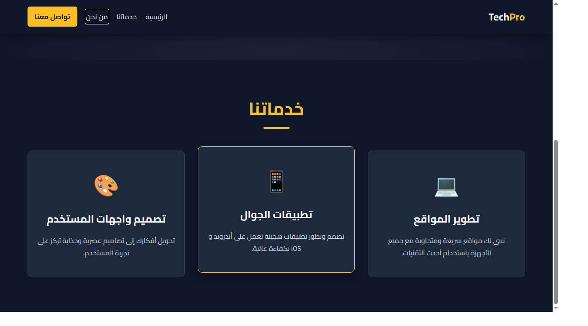
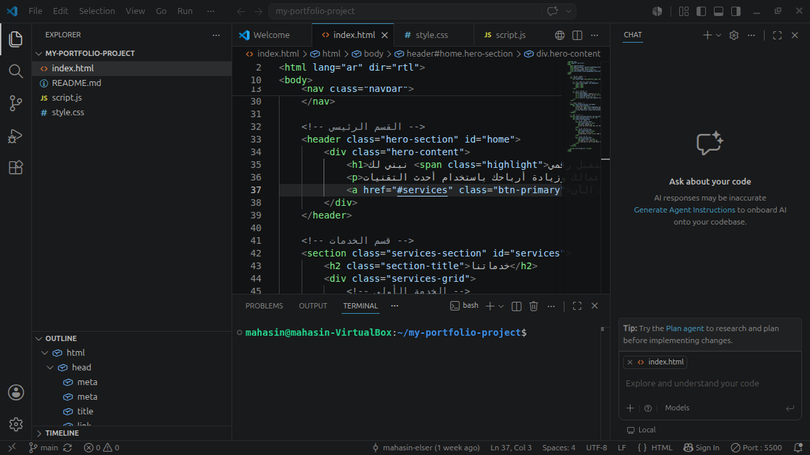

# TechPro Landing Page 🚀

A modern, fully responsive landing page for a tech company, built from scratch using HTML, CSS, and Vanilla JavaScript. This project is part of my professional portfolio.

## 📸 Project Screenshots

### Main View

### Services Section

### Clean Code (VS Code)

## ✨ Features
- **Fully Responsive:** Works perfectly on Desktop, Tablet, and Mobile.
- **Interactive Mobile Menu:** Hamburger menu for small screens (using JavaScript).
- **Scroll Effects:** Navbar changes color and adds a shadow upon scrolling.
- **Smooth Scrolling:** Internal links scroll smoothly to their sections.
- **Clean & Modern UI:** Dark theme with elegant gold accents.

## 🛠️ Technologies Used
- **HTML5:** Semantic structure.
- **CSS3:** Flexbox, CSS Grid, Media Queries, Animations.
- **JavaScript (ES6+):** DOM Manipulation, Event Listeners.

## 🚀 Live Demo
You can view the live project here: [Live Demo](https://mahasin-elser.github.io/my-portfolio-project/)
*(Note: Enable GitHub Pages to make this link work)*

## 👩‍💻 Author
**Mahasin Elser**
- GitHub: [@mahasin-elser](https://github.com/mahasin-elser)
